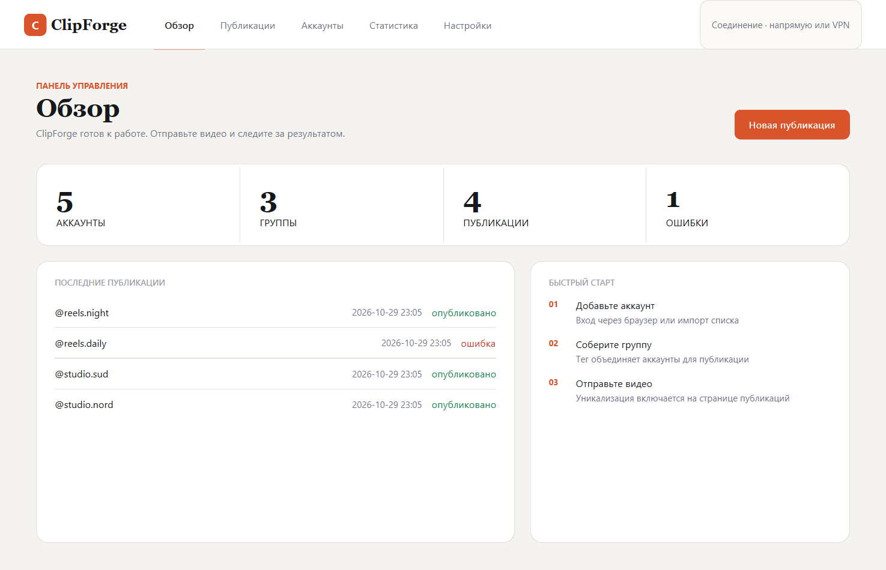
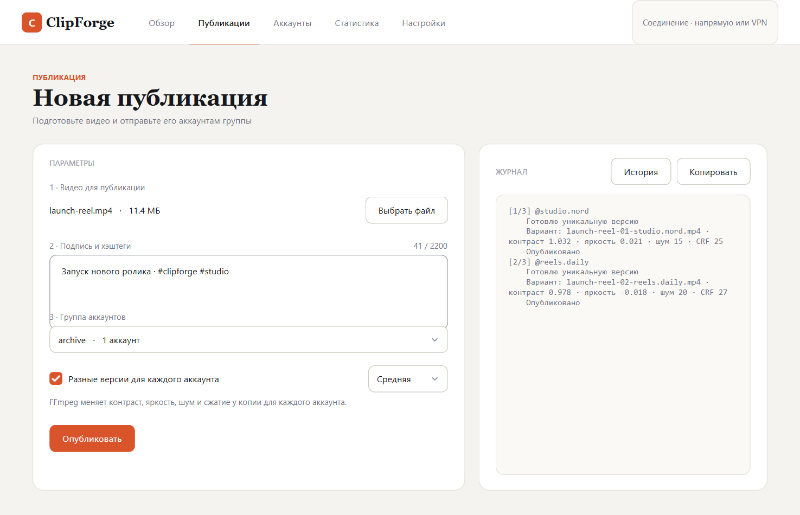
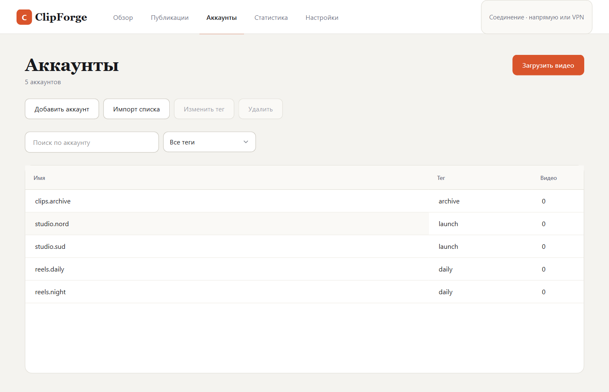
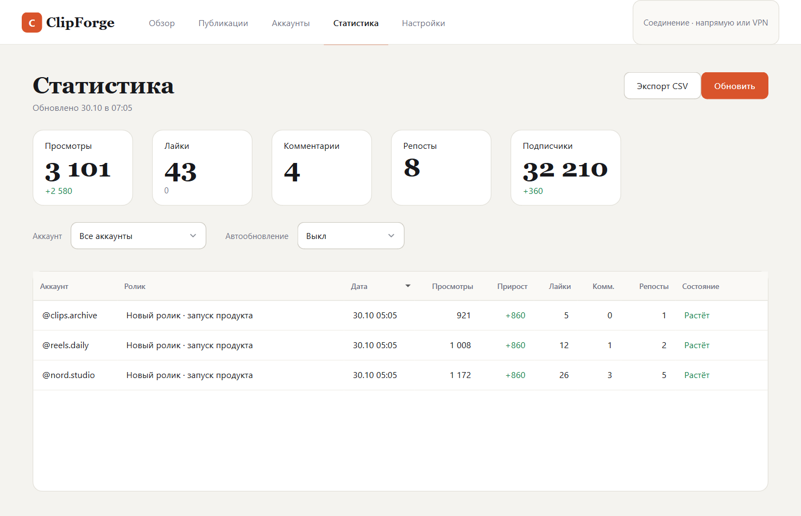
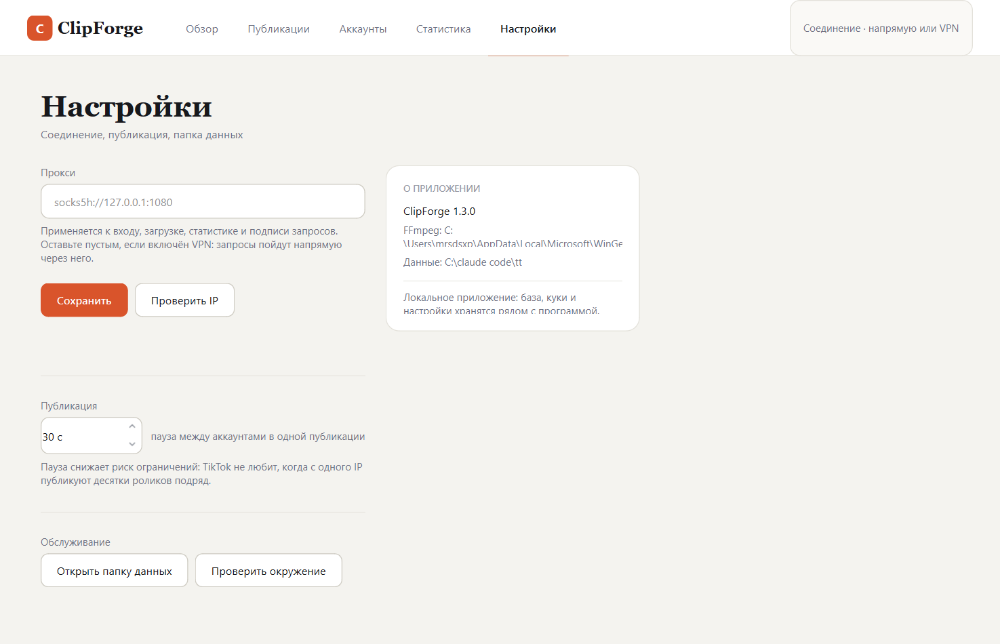

# ClipForge

<div align="center">

**Публикации и статистика TikTok без лишней суеты**

Одно видео — на группу аккаунтов. Каждому аккаунту можно собрать свою версию ролика.
Всё локально: база, куки и настройки лежат рядом с программой.

[](../../releases/latest)
[](#проверки)
[](#требования)
[](https://www.python.org/)
[](LICENSE)



</div>

---

## Возможности

| | |
| --- | --- |
| **Аккаунты**<br>Вход через браузер или по кукам, массовый импорт списка, группы по тегам, поиск и фильтр. | **Публикации**<br>Пошаговый сценарий видео → подпись → группа, пауза между аккаунтами, остановка, повтор ошибок, журнал причин. |
| **Уникализация**<br>Своя версия ролика для каждого аккаунта: контраст, яркость, шум и CRF по выбранной интенсивности. | **Статистика**<br>Просмотры, лайки, комментарии, репосты, подписчики, прирост с прошлого обновления, экспорт в CSV. |
| **Соединение**<br>Необязательный прокси SOCKS5/HTTP, проверка IP, диагностика Node.js, Chrome, FFmpeg и пакетов. | **Данные**<br>SQLite рядом с программой, версия схемы и резервная копия только перед реальной миграцией. |

## Скриншоты

<table>
<tr>
<td width="50%"><br><sub><b>Публикация</b> — шаги, группа, уникализация</sub></td>
<td width="50%"><br><sub><b>Аккаунты</b> — теги, поиск, массовые действия</sub></td>
</tr>
<tr>
<td width="50%"><br><sub><b>Статистика</b> — карточки, прирост, таблица роликов</sub></td>
<td width="50%"><br><sub><b>Настройки</b> — прокси, пауза, окружение</sub></td>
</tr>
</table>

## Уникализация видео

Включите «Разные версии видео для каждого аккаунта» на странице публикации и выберите интенсивность: лёгкая, средняя, сильная или случайная. Перед отправкой ClipForge вызывает FFmpeg и готовит отдельный файл: меняются контраст, яркость, шум и качество сжатия, метаданные сбрасываются.

- Варианты собираются во временную папку `data/variants` и удаляются после прогона.
- Ошибка кодирования помечает только один аккаунт — очередь продолжается.
- Нет FFmpeg — кнопка предупредит, а не упадёт; проверка есть в self-test и «Проверить окружение».

```powershell
# FFmpeg можно положить рядом с программой
ffmpeg\bin\ffmpeg.exe
# или указать путь явно
$env:CLIPFORGE_FFMPEG = "C:\tools\ffmpeg\bin\ffmpeg.exe"
```

## Требования

Windows, Python 3.10+, Google Chrome, Node.js. Для уникализации — FFmpeg.

## Запуск из исходников

```powershell
python -m venv .venv
.venv\Scripts\pip install -r requirements.txt
cd tiktok_uploader\tiktok-signature
npm install
npx playwright install chromium
cd ..\..
.venv\Scripts\python main.py
```

Скопируйте `.env.example` в `.env`, если нужен прокси. Проверка окружения: `.venv\Scripts\python main.py --selftest` — результат в `selftest.log`.

## Сборка exe

```powershell
.venv\Scripts\pip install pyinstaller
.venv\Scripts\python -m PyInstaller --noconfirm --clean --windowed --onedir --name ClipForge `
  --icon src/ui/assets/icon.ico `
  --add-data "src/ui/assets;src/ui/assets" `
  --add-data "tiktok_uploader/tiktok-signature;tiktok_uploader/tiktok-signature" `
  --collect-data fake_useragent `
  --collect-submodules undetected_chromedriver `
  --hidden-import tiktok_uploader.tiktok --hidden-import tiktok_uploader.stats `
  --exclude-module playwright --exclude-module aiohttp --exclude-module tkinter main.py
```

Или через готовый spec: `.venv\Scripts\python -m PyInstaller --noconfirm --clean ClipForge.spec`.

Готовая сборка — `dist\ClipForge\ClipForge.exe` вместе с `_internal`. Рядом создаются `data\`, `CookiesDir\` и `.env`. FFmpeg в архив не входит.

## Проверки

```powershell
.venv\Scripts\python -m pytest tests -q
.venv\Scripts\python -m compileall -q src tiktok_uploader main.py
$env:QT_QPA_PLATFORM='offscreen'; .venv\Scripts\python tests\smoke_gui.py
$env:QT_QPA_PLATFORM='offscreen'; .venv\Scripts\python tests\shots_clipforge.py
.venv\Scripts\python main.py --selftest
```

Скриншоты для README пересобираются так: `.venv\Scripts\python tests\shots_readme.py`.

## Архитектура

- `src/ui/` — оболочка, страницы, диалоги и визуальная система.
- `src/app/` — контракты и `ClipForgeService`, фасад для страниц.
- `src/core/` — база, куки, статистика, импорт и уникализация видео.
- `tiktok_uploader/` — изолированный адаптер TikTok и Node-подпись.

Подробнее — [docs/ARCHITECTURE.md](docs/ARCHITECTURE.md), релизный чек-лист — [docs/RELEASE.md](docs/RELEASE.md), сторонние компоненты — [docs/THIRD_PARTY.md](docs/THIRD_PARTY.md).

## Ограничения

- Работа идёт через неофициальные запросы TikTok: обновления платформы могут временно ломать интеграцию.
- TikTok может блокировать публикацию на уровне аккаунта или региона; массовая публикация повышает риск ограничений.
- Используйте только свои аккаунты и соблюдайте правила площадки.
- Куки хранятся в открытом виде в `CookiesDir/` — не публикуйте эту папку.
- Реальный login и upload требуют пользовательских аккаунтов и не входят в локальные проверки.

## Лицензия и авторство

MIT, см. [LICENSE](LICENSE). ClipForge is a substantially reworked open-source fork: the original MIT license and notices are preserved. Сохранены атрибуция [TikTokAutoUploader](https://github.com/y1ki/TikTokAutoUploader) (Y1ki) и [tiktok-signature](https://github.com/carcabot/tiktok-signature) (CarcaBot).
